# OMMA Platform

> **OMMA** (Organization of Multimedia Artists) is a commission site for student artists of STI College Las Piñas. Clients find an artist, send a brief, and pay through Xendit. The payment is held in OMMA's Xendit balance until the client approves the final work, then it is paid out to the artist (or split between a team of artists). Every uploaded artwork goes through an art check (hidden watermark, image fingerprint, EXIF scan, similarity search and the Hive AI-art check). Clients and artists talk in a live chat (Socket.io), and OMMA officers run an admin console for artist approval, art review, disputes and refunds.
>
> During the capstone, Xendit runs in sandbox (test) mode: no real money moves.

Link to append-only log: [CHANGELOG.md](./CHANGELOG.md)

---

## Tech Stack & Architecture

| Layer | Technology | Version | Role in OMMA |
| :--- | :--- | :--- | :--- |
| **Framework** | Next.js (App Router) | `^16.4.2` | Pages, server components and API route handlers. Hosted on Vercel (region `sin1`). |
| **UI library** | React / React DOM | `^19.3.1` | UI components. |
| **Runtime** | Node.js | `24.x` (`.nvmrc`) | Required Node version for the app, scripts and socket server. |
| **Styling** | Tailwind CSS v4 (`@tailwindcss/postcss`), `tailwind-merge` | `^4.0.0` / `^3.7.0` | White notebook-paper design from [DESIGN.md](./DESIGN.md): blue rules, red margin line, cadmium-red accent `#c9371c`, Young Serif (display), Hanken Grotesk (body), IBM Plex Mono (data only). Fonts load through `next/font`. |
| **Icons** | `lucide-react` | `^1.59.0` | SVG icons (no emojis in the UI). |
| **Analytics** | `@vercel/analytics` | `^2.0.1` | Page analytics, loaded only after the visitor accepts analytics cookies. |
| **Real-time** | Socket.io server and client | `^4.8.4` | Commission chat, typing status, live status updates and admin alerts. Runs as a separate Node service on Render. |
| **Socket scaling (optional)** | `@socket.io/redis-adapter`, `ioredis` | `^8.3.0` / `^5.11.1` | Used only when `REDIS_URL` is set, to share socket rooms across instances. |
| **Database / ORM** | PostgreSQL on Supabase, Prisma | `^5.14.0` (5.22 installed) | Schema in `prisma/schema.prisma`. Money is stored as integer centavos (`Int`) plus a currency code. Local and CI use Postgres 16. |
| **File storage** | Supabase Storage (S3-compatible) via `@aws-sdk/client-s3` and `s3-request-presigner` | `^3.1152.0` | Five buckets: public previews, avatars, WIP files, final deliveries and private KYC (student ID) images. Uploads and downloads use short-lived presigned URLs. |
| **Rate limits and OTP store** | Upstash Redis (`@upstash/redis`) | `^1.39.0` | Sliding-window rate limits and login codes. Required in production; an in-memory fallback is used only in development. |
| **Auth** | NextAuth.js (JWT sessions), `bcryptjs` | `^4.24.0` / `^3.0.3` | Email + password + email OTP for every role. Roles: `CUSTOMER`, `ARTIST`, `ADMIN`. |
| **Encryption at rest** | Node.js `crypto` (AES-256-GCM) | built in | Chat messages, artist student details, the KYC storage key. |
| **Image processing** | `sharp` | `^0.35.5` | Watermarking, fingerprints, avatar and ID-photo cleanup (metadata removed). |
| **EXIF scan** | `exifr` | `^7.1.0` | Looks for AI-tool signatures and date problems in uploaded images. |
| **AI-art check** | Hive Moderation API | REST | AI-generated image check. If Hive is not configured or fails, the artwork goes to officer review. |
| **Payments** | Xendit (`xendit-node`) | `^5.0.0` | Invoices (customer pays), Payouts v2 (artist payout), Refund API. Sandbox keys only unless `XENDIT_ALLOW_LIVE=true`. |
| **Money math** | `decimal.js` | `^10.6.0` | Exact fee and split math (`lib/money.ts`, 10% platform fee). |
| **Email** | Brevo API, with `nodemailer` + Gmail SMTP as fallback | `^10.1.7` | Login codes, password resets, artist decisions, commission status emails, refund and payout notices. |
| **Validation** | Zod | `^3.23.0` | Request body validation. |
| **Language / scripts** | TypeScript, `tsx` | `^5.4.0` / `^4.23.15` | Type checking; `tsx` runs the socket server, seed scripts and unit tests. |
| **Testing and checks** | Node test runner (via `tsx --test`), Playwright, Postman CLI / Newman, ESLint 9 (flat config, `eslint-config-next`), Gitleaks, CodeQL, Lighthouse CI | `@playwright/test ^1.64.1`, `eslint ^9.39.5` | Unit tests, browser tests and API tests run against a local server and a throwaway database. Nothing in the test jobs touches production. |
| **Request guard** | `proxy.ts` (Next 16's renamed middleware) | built in | CSRF origin check on API writes, role-based page routing, CSP with a nonce and security headers (HSTS, X-Frame-Options, X-Content-Type-Options and others). |
| **Hosting** | Vercel, Render (free plan), Supabase, GitHub Actions | - | Vercel: website and API. Render: socket server. Deploys run only from the CI deploy job. |

---

## Deployment Architecture

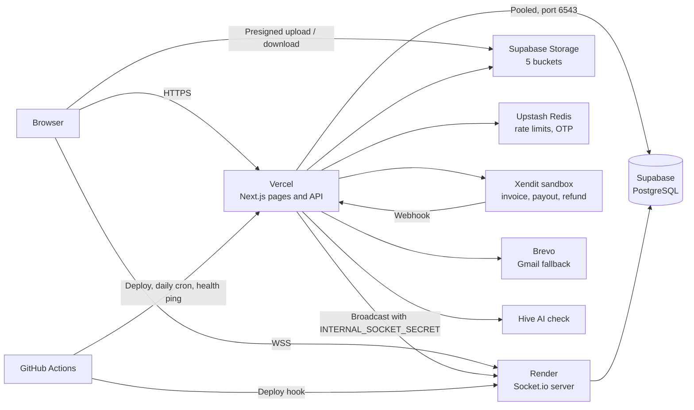

---

## Contract features (Article II) and where they live

| # | Contract feature | What it does in OMMA | Main code paths |
| :--- | :--- | :--- | :--- |
| 1 | Web-based commission management and tracking | Each commission records the date it was requested (`createdAt`), its deadline and the date it was completed (`completedAt`); when it completes it leaves the active queue and `completedOnTime` records whether it beat the deadline. | `app/api/commissions/route.ts`, `lib/commission-machine.ts`, `lib/deadline.ts`, `app/customer/commissions/`, `app/artist/commissions/`, `components/commission/StatusTracker.tsx`, `components/commission/CompletionBadge.tsx`, `app/api/commissions/auto-clean/route.ts` |
| 2 | User registration, login, profile management | People sign up as a customer or an STI artist, log in with password plus an email code, and edit their profile, avatar, password and payout details. | `app/(auth)/`, `app/api/register/route.ts`, `app/api/auth/`, `lib/auth.ts`, `lib/otp.ts`, `app/api/user/`, `app/customer/settings/`, `app/artist/settings/`, `app/onboarding/` |
| 3 | Artist portfolio and showcase module | Artists upload artworks to their portfolio; artworks that pass the art check appear in Explore and on the artist's public profile. | `app/artist/portfolio/`, `app/api/artworks/route.ts`, `app/(public)/explore/`, `app/(public)/artist/[username]/page.tsx`, `app/(public)/profile/[id]/`, `components/discover/OMMAFeed.tsx` |
| 4 | Client-to-artist real-time communication via Socket.io | Each commission has its own encrypted chat room with typing status and new-message alerts. | `server/index.ts`, `app/api/socket-token/route.ts`, `app/api/messages/route.ts`, `components/commission/ChatPopupManager.tsx`, `components/providers/SocketProvider.tsx`, `hooks/useSocket.ts` |
| 5 | Administrative dashboard for OMMA officers | Officers see platform numbers, approve or decline artists, review flagged art and users, resolve disputes and refunds, and read the audit log. | `app/admin/` (dashboard, users, review, audit, settings), `app/api/admin/`, `components/admin/CommissionDisputesPanel.tsx` |
| 6 | Notification and status update system for commission requests | Every status change sends a live update to all parties and an email to everyone except the person who made the change. | `lib/notifications/commission-status.ts`, `lib/email.ts`, `hooks/useCommissionLiveUpdates.ts`, `components/commission/StatusTracker.tsx` |
| 7 | AI Detection and Anti-Scraping Module (Hive API) | Every upload gets a hidden watermark and is checked with EXIF, similarity and Hive; anything doubtful goes to an officer. Previews are protected by a screenshot guard and a bot trap endpoint. | `app/api/auth-check/route.ts`, `lib/art-auth/`, `app/admin/review/`, `hooks/useScreenshotProtection.ts`, `components/auth-shield/CanvasSecureViewer.tsx`, `app/api/security/`, `lib/security/` |
| 8 | Secure payment processing via Xendit | The customer pays a Xendit invoice; the money is held in OMMA's Xendit balance until the client approves the final work, then paid out (or refunded by an officer). | `lib/xendit.ts`, `lib/payments/`, `lib/money.ts`, `app/api/transactions/deposit/route.ts`, `app/api/webhooks/xendit/route.ts`, `app/api/admin/commissions/[id]/resolve/route.ts` |

Features beyond Article II that already existed before the contract (bounties and team split payouts, the artist forum, the social feed and comments, and artist recommendations) are kept. They get bug and security fixes only.

### Out of scope – requires a change request (Art. 8.2/8.4)

These are **not built**. Adding any of them needs a change request under Article 8.2/8.4:

- **Multi-party video/audio briefing rooms**: WebRTC live sketching and voice rooms for customer-artist direction.
- **Mobile push notifications**: Progressive Web App (PWA) push notifications for approvals, bounty nominations and payouts.
- An AI chatbot, or any AI feature beyond AI-art detection and anti-scraping.
- Payment gateways other than Xendit.
- Live video or live streaming.
- A mobile app.
- Advanced analytics dashboards.
- Third-party APIs that are not in the original scope.

---

## Whole Process Flowchart (Start to Finish)

From a visitor on the home page to a finished commission. Status names in capitals are the `CommissionStatus` values used in the code.

```mermaid
flowchart TD
    subgraph S1["1. Public site"]
        V1(["Visitor opens the home page"])
        V2["How it works, About, FAQ, Contact,<br/>Explore, artist profiles, legal pages"]
        V3["Verify art: upload a file and<br/>read its hidden OMMA watermark"]
    end
    V1 --> V2
    V2 --> V3

    subgraph S2["2. Sign up and log in"]
        R0{"Customer or<br/>STI artist?"}
        RC["Customer form<br/>Terms and Privacy boxes, 18+"]
        RA["Artist form: student details,<br/>birthdate 18+, student ID photo,<br/>Terms, Privacy and ID-check boxes"]
        OF{"Officer checks the<br/>student ID in /admin/users"}
        DEC["Declined: email with the reason<br/>and a one-time re-apply link"]
        L1["Log in: email and password"]
        L2["6-digit code by email<br/>10 minutes, 5 tries"]
        L3["Session starts on the<br/>role home page"]
    end
    V2 --> R0
    R0 -->|Customer| RC
    R0 -->|Artist| RA
    RA --> OF
    OF -->|Decline| DEC
    DEC -->|"New ID photo"| OF
    OF -->|Approve| L1
    RC --> L1
    L1 --> L2
    L2 --> L3

    subgraph S3["3. Artist portfolio"]
        P1["Artist uploads an artwork"]
        P2["Art check: fingerprint, hidden watermark,<br/>EXIF, similarity, Hive AI check"]
        P3{"Result"}
        P4["VERIFIED: shown in Explore<br/>and on the profile"]
        P5["Officer review<br/>in /admin/review"]
    end
    L3 -->|Artist| P1
    P1 --> P2
    P2 --> P3
    P3 -->|VERIFIED| P4
    P3 -->|"MANUAL_REVIEW or FLAGGED"| P5
    P5 -->|Verify| P4

    subgraph S4["4. Request and payment"]
        C1["Customer finds an artist and sends<br/>a brief, price and deadline<br/>PENDING_ARTIST"]
        C2{"Artist accepts?"}
        CX["CANCELLED"]
        C3["NEGOTIATING<br/>details agreed in chat"]
        C4["Customer pays a Xendit invoice<br/>AWAITING_DEPOSIT, test mode"]
        C5{"Webhook: paid and<br/>amount matches?"}
        C6["IN_PROGRESS<br/>money held in OMMA's Xendit balance"]
    end
    L3 -->|Customer| C1
    P4 -.-> C1
    C1 --> C2
    C2 -->|No| CX
    C2 -->|Yes| C3
    C3 --> C4
    C4 --> C5
    C5 -->|"Invoice expired"| C3
    C5 -->|Paid| C6

    subgraph S5["5. Work and delivery"]
        W1["Chat over Socket.io,<br/>live and email status updates"]
        W2["Optional team: bounty, co-artist applies,<br/>lead picks, client approves team and split"]
        W3["Artist submits work<br/>UNDER_REVIEW"]
        W4{"Customer decision"}
        W5["AUTH_CHECK<br/>artist uploads the final file"]
        W6["Art check on the final file,<br/>officer review if flagged"]
        W7["DELIVERED"]
    end
    C6 --> W1
    W1 --> W2
    W2 --> W3
    W1 --> W3
    W3 --> W4
    W4 -->|"Revision, up to 3"| W1
    W4 -->|"Approve preview"| W5
    W5 --> W6
    W6 -->|VERIFIED| W7

    subgraph S6["6. Finish"]
        F1["Customer approves the final work<br/>PAYOUT_PROCESSING"]
        F2["Xendit payout to each artist,<br/>split if a team, 10% fee kept"]
        F3["Payout webhook: COMPLETED<br/>leaves the active queue"]
        F4["Customer downloads the file<br/>with a single-use link<br/>tied to their account"]
        F5["Survey 1-5 stars and<br/>team peer reviews"]
        F6(["Daily auto-clean: repairs completion<br/>records, archives finished bounties"])
        FR["PAYOUT_RECONCILIATION<br/>officer retries the payout"]
    end
    W7 --> F1
    F1 --> F2
    F2 -->|Succeeded| F3
    F2 -->|Failed| FR
    FR --> F2
    F3 --> F4
    F3 --> F5
    F4 --> F6
    F5 --> F6

    subgraph S7["Refund or dispute"]
        DR["Customer or officer asks for a refund<br/>IN_PROGRESS to DELIVERED"]
        DD["Customer or artist raises a dispute<br/>DELIVERED only"]
        DF["Art check or officer flags<br/>the final file in AUTH_CHECK"]
        D1["DISPUTED<br/>officers, artist and customer emailed"]
        D2{"Officer decides"}
        D3["Refund via Xendit Refund API<br/>webhook: CANCELLED"]
    end
    W1 -.-> DR
    W7 -.-> DD
    W6 -.->|Flagged| DF
    DR --> D1
    DD --> D1
    DF --> D1
    D1 --> D2
    D2 -->|Refund| D3
    D2 -->|"Release to artist"| F2
```

---

## Process Flowcharts

### 1. Sign-up and email OTP login

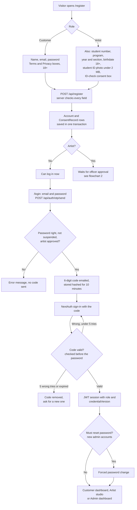

Resending a code has a 30-second cooldown and a limit of 4 per 10 minutes. Forgot-password links last 1 hour.

### 2. Artist student-ID check and re-apply

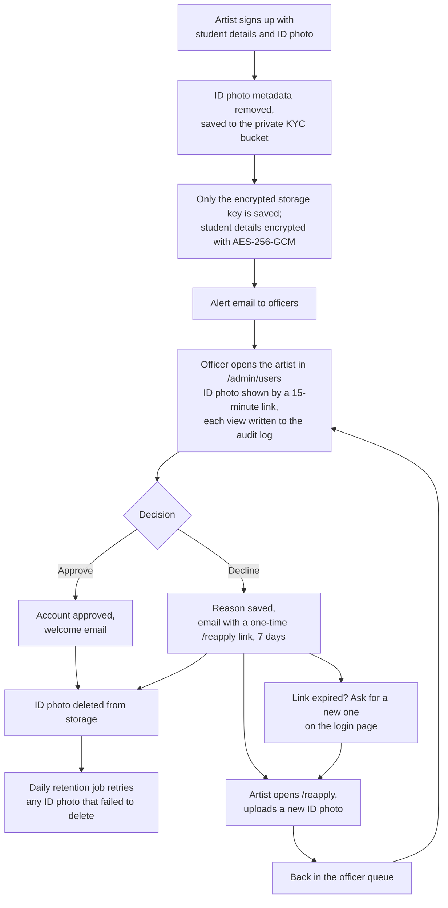

### 3. Artwork upload, art check and officer review

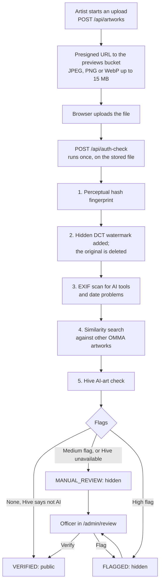

The same check runs on a commission's final file. When that file is verified, the commission moves from `AUTH_CHECK` to `DELIVERED`, and the checked bytes are copied to the private deliveries bucket.

### 4. Commission status lifecycle

Who can make each move (from `lib/commission-machine.ts`). "System" means payment code or a webhook, never a plain status change. An admin may take any move that is not system-only.

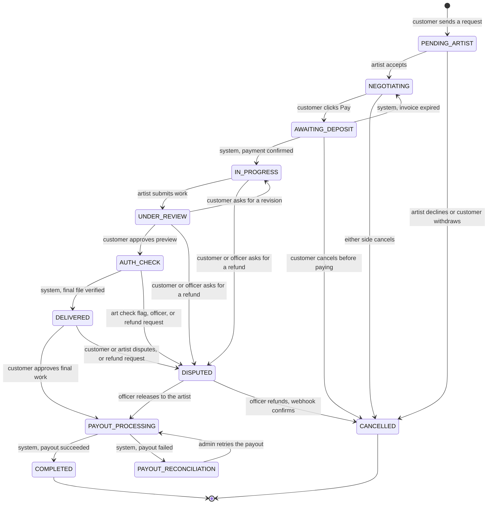

Each commission includes 3 revisions by default (`revisionsAllowed`).

Who can start a refund or dispute, and how it ends:

| Action | Who | From | Result |
| :--- | :--- | :--- | :--- |
| Ask for a refund (`POST /api/commissions/[id]/refund`) | The customer, or an officer | `PENDING_ARTIST`, `NEGOTIATING`, `AWAITING_DEPOSIT` | `CANCELLED` straight away (any open invoice is expired) |
| Ask for a refund (same route) | The customer, or an officer | `IN_PROGRESS`, `UNDER_REVIEW`, `AUTH_CHECK`, `DELIVERED` | `DISPUTED` (refused once the payout has started) |
| Raise a dispute (`PATCH /api/commissions`) | The customer or the artist | `DELIVERED` | `DISPUTED` |
| Flag the final file | The art check, or an officer | `AUTH_CHECK` | `DISPUTED` |
| Resolve (`POST /api/admin/commissions/[id]/resolve`) | Officers only | `DISPUTED` | `REFUND`: Xendit refund, then `CANCELLED` when the refund webhook confirms. `RELEASE`: `PAYOUT_PROCESSING` |

### 5. Payment, webhook, payout and refund

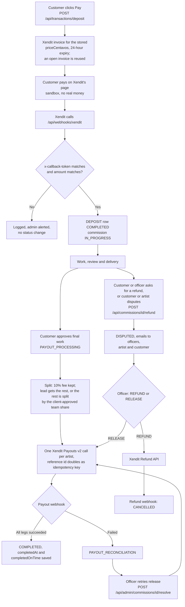

Before payment, a refund request simply cancels the commission (and expires any open invoice). Each webhook event runs in one database transaction with the commission row locked, so repeats are ignored.

### 6. Team collaboration (bounty) and split payout

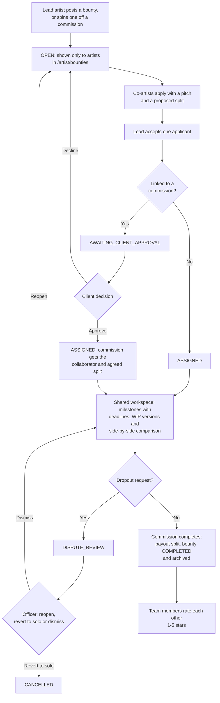

Split math (`lib/money.ts`): the platform keeps 10%. The collaborator gets their agreed percent of the remaining 90%, and any odd centavo goes to the lead artist. The collaborator is paid only if the client approved the team.

### 7. Real-time chat and notifications

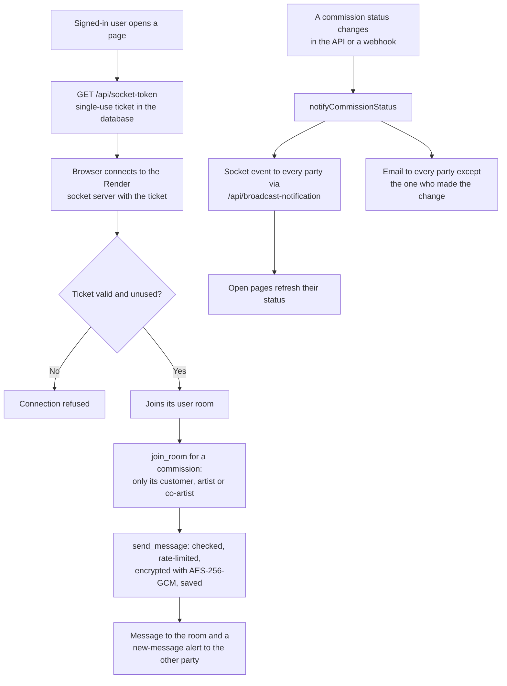

### 8. Screenshot guard

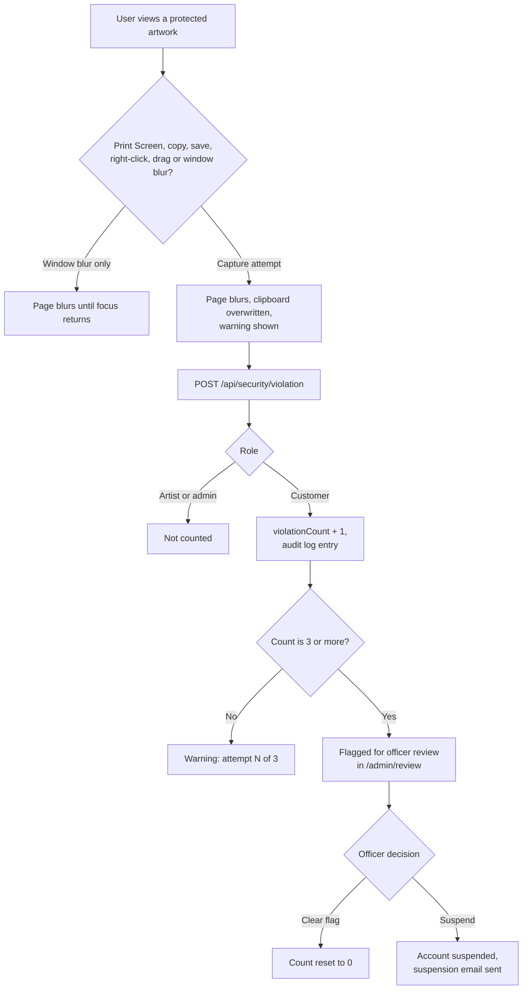

Nothing is suspended automatically. Only an officer can suspend an account.

### 9. Data rights and daily jobs

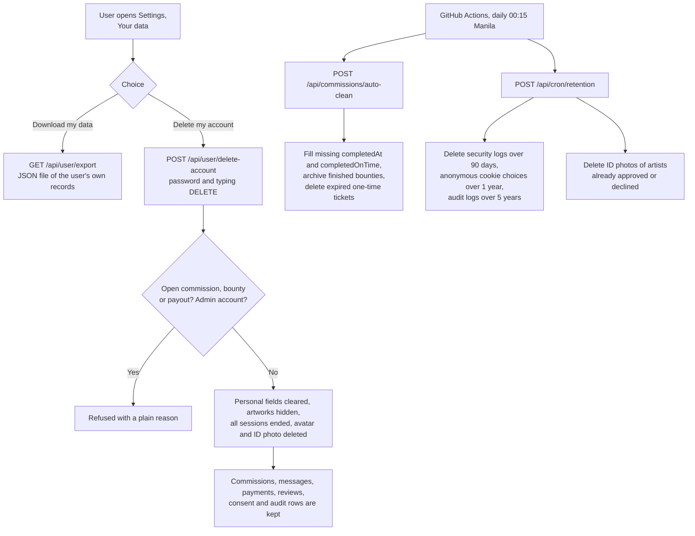

Both cron routes accept only `Authorization: Bearer CRON_SECRET` (auto-clean also accepts an admin session).

### 10. CI/CD deploy gate

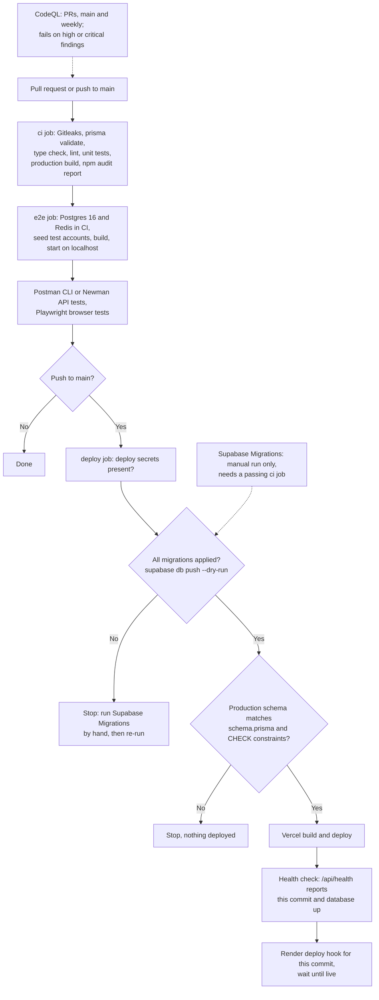

Other workflows: `cron.yml` (daily auto-clean and retention), `health-cron.yml` (hourly ping of the production `/api/health`), `lighthouse.yml` (audits a deployed site after a deploy or by hand), `supabase-migrate.yml` (file-name and SQL syntax check on pull requests; applies migrations only when run by hand). Vercel and Render auto-deploy are turned off, so production changes only through the CI deploy job.

---

## Running tests

| Command | What it does |
| --- | --- |
| `npm test` | Unit tests in `__tests__/` (Node test runner through tsx). |
| `npm run test:coverage` | The same unit tests with a coverage report. |
| `npm run lint` | ESLint 9 over the whole project. |
| `npm run typecheck` | `next typegen` then `tsc --noEmit`. |
| `npm run check` | Lint, type check, unit tests and build, one after another. |
| `npm run test:api` | Postman collection (`postman/omma_collection.json`) with Newman against `http://localhost:3000`. |
| `npm run test:e2e` | Playwright browser tests in `e2e/` (Chromium). |

The API and browser tests need the app running on a **local test database**, never the live site. The `e2e` job in `.github/workflows/ci.yml` shows the full setup: Postgres 16, Redis with `hiett/serverless-redis-http` in front (rate limiting needs Upstash-style Redis in production mode), `npx prisma db push`, `npm run seed:ci` (test accounts; it refuses any database that is not on localhost), `npm run build`, `npm run start`, then the tests. Use made-up values for every secret, set `E2E_BASE_URL` if the app is not on port 3000, and run `npx playwright install chromium` once. Next.js also reads `.env` and `.env.local`, so run the tests from a copy of the project without your own `.env` files (otherwise values such as `UPSTASH_REDIS_URL` or `R2_ENDPOINT_URL` from them are used).

Other scripts: `npm run dev` (Next dev server), `npm run socket` (socket server locally, reads `.env` and `.env.local`), `npm run start:socket` (socket server in production), `npm run seed:admin` (creates the first admin from `PRIMARY_ADMIN_EMAIL` / `PRIMARY_ADMIN_PASSWORD`). `docker-compose.yml` starts a local Postgres 16 on port 5435.

---

## Folder Structure

```
OMMA/
├── app/
│   ├── (auth)/            # login, register, verify, forgot-password, reset-password, reapply
│   ├── (public)/          # home page, how-it-works, about, faq, contact, explore, verify-art,
│   │                      # artwork/[id], artist/[username], profile/[id], and the legal pages
│   │                      # (terms, privacy, cookies, refund, dpa)
│   ├── admin/             # officer console: dashboard, users, review, audit, settings
│   ├── artist/            # artist workspace: studio, portfolio, commissions, bounties,
│   │                      # messages, earnings, forum, settings
│   ├── customer/          # customer workspace: dashboard, commissions, messages,
│   │                      # transactions, settings
│   ├── onboarding/        # first-login preferences wizard
│   ├── api/               # route handlers (see API Reference)
│   ├── globals.css        # design tokens and notebook-paper styles
│   ├── layout.tsx         # root layout, fonts, providers, cookie banner
│   ├── robots.ts, sitemap.ts, error.tsx, global-error.tsx, not-found.tsx
├── components/
│   ├── site/              # public-site building blocks: SiteShell, Scene, PageHero,
│   │                      # FeaturedWork, WatermarkCompare, ContactActions, ButtonLink
│   ├── layout/            # Navbar, AppHeader, SidePanel, Footer, CookieConsent
│   ├── commission/        # commission form, status tracker, chat popups, delivery upload,
│   │                      # survey and payment components
│   ├── bounty/            # bounty feed, apply and applicant modals, client approval card,
│   │                      # workspace, WIP comparison, peer review, agreement summary
│   ├── discover/          # feed, artwork detail, watermark validator
│   ├── admin/             # CommissionDisputesPanel
│   ├── auth-shield/       # ArtAuthBadge, CanvasSecureViewer
│   ├── settings/          # AccountPrivacySection (download or delete my data)
│   ├── legal/             # legal page layout, sidebar, list of processors
│   ├── providers/         # Auth, Socket, Chat, Feedback, ConsentAnalytics
│   ├── skeletons/         # loading placeholders per page type
│   ├── profile/, ui/      # ProfileSkeleton; Avatar, Button, EmptyState, ImageGuard, etc.
├── hooks/                 # useScreenshotProtection, useSocket, useCommissionLiveUpdates,
│                          # useTransactionLedger
├── lib/
│   ├── art-auth/          # pHash, DCT watermark, EXIF, similarity and Hive check
│   ├── payments/          # deposit, webhook helpers, payout, refund, alerts
│   ├── security/          # bot detection, screenshot guard, violation rules
│   ├── validation/        # Zod and plain validators (registration, profile, messages, URLs)
│   ├── notifications/     # commission status notices (socket + email)
│   ├── auth.ts, auth-guard.ts, otp.ts, csrf.ts     # sessions, DB-checked guards, codes
│   ├── commission-machine.ts, bounty-machine.ts     # allowed status moves
│   ├── money.ts, xendit.ts, payment-mode.ts         # centavo math, Xendit calls, test mode
│   ├── s3.ts, crypto.ts, email.ts, redis.ts, legal.ts, account-deletion.ts, ...
├── server/index.ts        # Socket.io server (Render)
├── prisma/schema.prisma   # database models
├── supabase/
│   ├── migrations/        # SQL migrations applied to production (RLS, money, consent, ...)
│   └── scripts/           # reference RLS scripts
├── scripts/               # seed-admin, ci-seed, set-admin-avatar
├── __tests__/             # unit tests
├── e2e/                   # Playwright tests
├── postman/               # API test collection
├── .github/workflows/     # ci, codeql, cron, health-cron, lighthouse, supabase-migrate
├── proxy.ts               # CSRF, role routing, CSP and security headers
├── DESIGN.md              # design system
├── render.yaml            # Render service for the socket server
├── vercel.json            # region sin1, auto-deploy of main turned off
└── docker-compose.yml     # local Postgres 16
```

---

## Database Schema (Entity Relationship Diagram)

Generated from `prisma/schema.prisma`. Money columns are integer centavos (`Int`, PHP 1.00 = 100) with a 3-letter `currency` (default `PHP`). `Commission.collaboratorId` and `Comment.artworkId` are plain ID columns without a Prisma relation.

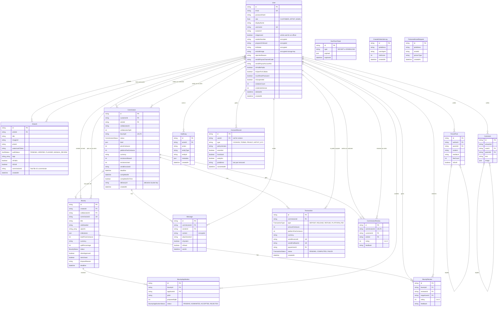

Money rules are also enforced by database `CHECK` constraints (`Commission_money_check`, `Bounty_split_check`, `CommissionReview_rating_check` and others), and the deploy job checks that they exist in production.

---

## Access Control and Row-Level Security (RLS)

**How access is really enforced.** The app talks to the database through Prisma with a privileged database role, so Postgres RLS does **not** protect the app's own queries. Access control lives in the app:

- `proxy.ts` checks the session cookie on every request: CSRF origin check on API writes, `/admin` for admins only, the artist workspace for artists (and admins), `/customer` for customers (and admins), and a list of public pages and endpoints.
- Route handlers check the session again against the database: `requireAuth` in `lib/auth-guard.ts` (user exists, not suspended or deleted, same `credentialVersion`, role read from the database), or `getServerSession`, whose JWT callback in `lib/auth.ts` re-checks suspension, deletion and `credentialVersion` on every call.
- Each route then checks ownership (for example, only the commission's customer can pay or approve) and the allowed status moves in `lib/commission-machine.ts` and `lib/bounty-machine.ts`.

**What RLS is for.** RLS policies in `supabase/migrations/` are defense in depth for anyone reaching the database directly through Supabase (for example with the public API keys). They are not the main access control.

Migrations in `supabase/migrations/`:

- `20260912105745_drop_duplicate_indexes.sql`: removed duplicate indexes on the like/save link tables (later reversed, see the last migration).
- `20260912110000_comprehensive_rls.sql`: turns on RLS for every table and adds the policies, with `auth.uid()` wrapped in a sub-select so it runs once per query.
- `20260912133200_fix_publicprofile_security_invoker.sql`: rebuilds the `PublicProfile` view with `security_invoker = true` so it follows the caller's RLS.
- `20261005070915_add_consent_record.sql`: adds `ConsentRecord` with its RLS policies.
- `20261016020000_money_centavos_expand.sql`: adds the integer centavo and currency columns and fills them.
- `20261022020000_phase5_consent_type_and_account_deletion.sql`: adds `ConsentRecord.type`, `policyVersion` and `User.deletedAt`.
- `20261022120000_money_contract_and_link_tables.sql`: drops the old decimal money columns, makes the centavo columns required, validates the money `CHECK` constraints, and gives the like/save link tables the unique `(A, B)` index Prisma expects.

`supabase/scripts/` holds reference RLS scripts; they are not applied automatically.

---

## Environment Variables (Names Only)

Copy `.env.local.example` to `.env.local` and fill in your own values. Never commit real values.

**App (Vercel)**

```env
DATABASE_URL
DIRECT_URL
NEXTAUTH_SECRET
NEXTAUTH_URL
MESSAGE_ENCRYPTION_KEY
WATERMARK_HMAC_SECRET
R2_ACCESS_KEY_ID
R2_SECRET_ACCESS_KEY
R2_ENDPOINT_URL
STORAGE_REGION
R2_BUCKET_PREVIEWS
R2_BUCKET_AVATARS
R2_BUCKET_WIP
R2_BUCKET_DELIVERIES
R2_BUCKET_KYC
OMMA_PREVIEWS_PUBLIC_BASE
NEXT_PUBLIC_SOCKET_SERVER_URL
SOCKET_SERVER_URL
INTERNAL_SOCKET_SECRET
XENDIT_SECRET_KEY
XENDIT_WEBHOOK_TOKEN
XENDIT_ALLOW_LIVE
BREVO_API_KEY
BREVO_SENDER_EMAIL
BREVO_SENDER_NAME
ADMIN_ALERT_EMAIL
ENABLE_EMAIL_MOCK
GMAIL_USER
GMAIL_APP_PASSWORD
UPSTASH_REDIS_URL
UPSTASH_REDIS_TOKEN
HIVE_SECRET_KEY
CRON_SECRET
```

The `R2_*` names are kept from an earlier storage setup; they now point at Supabase Storage's S3 endpoint. Optional ones: `WATERMARK_HMAC_SECRET` (falls back to `NEXTAUTH_SECRET`), `OMMA_PREVIEWS_PUBLIC_BASE`, `SOCKET_SERVER_URL`, `XENDIT_ALLOW_LIVE` (leave false), `BREVO_SENDER_NAME`, `ADMIN_ALERT_EMAIL`, `ENABLE_EMAIL_MOCK` (development only), `GMAIL_*`, and `HIVE_SECRET_KEY` (without it every upload goes to officer review). The code also accepts `UPSTASH_REDIS_REST_URL` / `UPSTASH_REDIS_REST_TOKEN` and `HIVE_API_KEY` as alternate names.

**Socket server (Render)**

```env
DATABASE_URL
NEXTAUTH_SECRET
MESSAGE_ENCRYPTION_KEY
INTERNAL_SOCKET_SECRET
CORS_ORIGIN
SOCKET_PORT
SOCKET_MAX_BODY_BYTES
REDIS_URL
```

**Scripts**

```env
PRIMARY_ADMIN_EMAIL
PRIMARY_ADMIN_PASSWORD
CI_SEED_PASSWORD
```

**GitHub Actions** (repository secrets and variables, not in `.env` files): `CRON_SECRET`, `POSTMAN_API_KEY`, `VERCEL_TOKEN`, `VERCEL_ORG_ID`, `VERCEL_PROJECT_ID`, `RENDER_DEPLOY_HOOK_URL`, `RENDER_API_KEY`, `SUPABASE_ACCESS_TOKEN`, `SUPABASE_DB_PASSWORD`, variable `SUPABASE_PROJECT_REF`, optional variable `SUPABASE_POOLER_HOST`.

---

## API Reference

All routes are in `app/api/**/route.ts`. Writes (POST, PATCH, DELETE) must come from the site's own origin (CSRF check in `proxy.ts`), except the Xendit webhook and the two cron routes. Most routes are rate-limited.

| Endpoint | Method | Who can call | What it does |
| :--- | :--- | :--- | :--- |
| `/api/register` | POST | Public | Creates a customer or artist account with consent records; artists upload a student ID photo. |
| `/api/auth/[...nextauth]` | GET, POST | Public | NextAuth sign-in with email, password and the email code; sign-out; session. |
| `/api/auth/otp/send` | POST | Public | Checks email and password, then emails a 6-digit login code. |
| `/api/auth/otp/resend` | POST | Public | Sends a new code (30-second cooldown, 4 per 10 minutes). |
| `/api/auth/forgot-password` | POST | Public | Emails a 1-hour password reset link. |
| `/api/auth/reset-password` | POST | Public (reset link) | Sets a new password and ends old sessions. |
| `/api/auth/first-login-reset` | POST | Signed in | Forced password change on first login (new admins). |
| `/api/auth/session-expired` | GET | Anyone | Clears a session cookie the database no longer accepts. |
| `/api/artist/reapply` | GET, POST | Public (one-time link) | GET checks a re-apply link; POST sends new student details and ID photo. |
| `/api/artist/reapply/link` | POST | Public | Emails a declined artist a fresh re-apply link (same answer for every email). |
| `/api/artworks` | GET | Public | Lists artworks; others see only public `VERIFIED` work, owners see their own. |
| `/api/artworks` | POST, PATCH, DELETE | Artist, Admin | Starts an upload (presigned URL), edits, or deletes an artwork. |
| `/api/auth-check` | POST | Artist, Admin | Runs the art check on an uploaded artwork. |
| `/api/art-auth/extract` | POST | Public (guests rate-limited by IP) | Verify art: reads the hidden watermark and fingerprint from a file. |
| `/api/feed` | GET | Signed in | Explore feed with cursor paging. |
| `/api/profile/[id]` | GET | Public | Profile, galleries, rating stats and reviews (less for private profiles). |
| `/api/profile/interactions` | GET, POST | Signed in | Lists or toggles likes and saves. |
| `/api/comments` | GET | Public | Comments on an artwork. |
| `/api/comments` | POST, DELETE | Signed in (delete: author or admin) | Adds or deletes a comment. |
| `/api/forum` | GET, POST, PATCH, DELETE | Artist, Admin (delete: author or admin) | Artist-only forum: list, post, change draft state, delete. |
| `/api/commissions` | GET | Signed in | The user's commissions (`activeOnly=true` hides completed and cancelled). |
| `/api/commissions` | POST | Customer, Admin | Sends a commission request (brief, price, optional deadline). |
| `/api/commissions` | PATCH | Commission party, Admin | Moves the status (rules in `lib/commission-machine.ts`); approving the final work starts the payout; the customer or artist can dispute a `DELIVERED` commission. |
| `/api/commissions/[id]/delivery` | POST | The commission's artist | Presigned upload for the final file (only in `AUTH_CHECK`). |
| `/api/commissions/[id]/refund` | POST | The commission's customer, Admin | Cancels before payment, or moves a paid commission (`IN_PROGRESS` to `DELIVERED`) to `DISPUTED`. Refused during payout. |
| `/api/commissions/[id]/survey` | POST | Customer, Admin | 1-5 star rating and feedback for a completed commission. |
| `/api/commissions/[id]/download-token` | POST | Commission party, Admin | Single-use, 15-second download token for the person who asked (only when `COMPLETED`). |
| `/api/download` | GET | Signed in, same user as the token | Checks the token belongs to the signed-in user, uses it up, and redirects to a 5-second presigned file link. Someone else's token is refused and not used up. |
| `/api/commissions/auto-clean` | POST | Cron secret or Admin | Daily queue cleanup. |
| `/api/cron/retention` | POST | Cron secret only | Daily retention cleanup. |
| `/api/transactions` | GET | Signed in | The user's payment records. |
| `/api/transactions/deposit` | POST | The commission's customer, Admin | Creates or reuses a Xendit invoice and returns its checkout URL. |
| `/api/webhooks/xendit` | POST | Xendit (`x-callback-token`) | Invoice, payout and refund callbacks. |
| `/api/bounties` | GET, POST | Artist, Admin | Lists bounties; creates one (optionally linked to a commission). |
| `/api/bounties/[id]` | GET | Artist, Admin, client of the linked commission | Bounty detail with applications. |
| `/api/bounties/[id]` | PATCH, DELETE | Bounty creator or team, Admin | Edits milestones, WIPs and allowed status moves; deletes. |
| `/api/bounties/[id]/apply` | POST | Artist | Applies with a pitch and proposed split. |
| `/api/bounties/[id]/applications/[appId]` | PATCH | Bounty creator, Admin | Accepts or rejects an applicant. |
| `/api/bounties/[id]/client-approve` | POST | Client of the linked commission, Admin | Approves or declines the nominated co-artist. |
| `/api/bounties/[id]/dropout` | POST | Team member, Admin | Requests a dropout; bounty goes to `DISPUTE_REVIEW`. |
| `/api/bounties/[id]/review` | POST | Team member | Peer review, 1-5 stars. |
| `/api/bounties/[id]/reminders` | POST | Team member, Admin | Emails milestone deadline reminders. |
| `/api/messages` | GET, POST | Commission party, Admin | Reads (decrypted) or adds chat messages. |
| `/api/socket-token` | GET | Signed in | Single-use ticket for the socket connection. |
| `/api/security/violation` | POST | Signed in | Records a screenshot attempt (customers only are counted). |
| `/api/security/honeypot` | GET | Public | Bot trap, linked from a hidden footer link that people never see: logs the visit and returns a decoy. |
| `/api/consent` | POST | Public | Saves a cookie choice as a `ConsentRecord`. |
| `/api/health` | GET | Public | Database and Redis status plus the build's commit. |
| `/api/user/update-profile` | POST | Signed in | Updates profile and artist payout details. |
| `/api/user/avatar` | POST, DELETE | Signed in | Uploads (5 MB limit, file type checked) or removes the user's own avatar. |
| `/api/user/change-password` | POST | Signed in | Changes the password and ends other sessions. |
| `/api/user/recommend-artists` | GET | Signed in | Artists matching chosen genres. |
| `/api/user/export` | GET | Signed in | Downloads the user's own data as JSON. |
| `/api/user/delete-account` | POST | Signed in (not admins) | Deletes the user's own account. |
| `/api/admin/stats` | GET | Admin | Dashboard numbers. |
| `/api/admin/users` | GET, POST, PATCH | Admin | Lists users; creates an admin (temporary password emailed only); approves or declines an artist. |
| `/api/admin/users/[id]` | GET | Admin | One user's personal details and ID photo link (view is audit-logged). |
| `/api/admin/review` | GET, PATCH | Admin | Artworks and flagged users to review; VERIFY or FLAG an artwork; CLEAR_FLAG or SUSPEND a user. |
| `/api/admin/commissions/[id]/resolve` | POST | Admin | REFUND or RELEASE a disputed commission, or retry a failed payout. |
| `/api/admin/bounties/disputes` | GET | Admin | Bounties in `DISPUTE_REVIEW`. |
| `/api/admin/bounties/[id]/arbitrate` | POST | Admin | Reopen, revert to solo, or dismiss a bounty dispute. |
| `/api/admin/audit` | GET | Admin | Audit log search. |

---

## Features List

- **Public site**: notebook-paper design (see `DESIGN.md`) with a home page story, How it works, About, FAQ, Contact, Explore, artist profiles, and Privacy, Terms, Cookies, Refund and DPA pages. The home page shows the newest public, art-checked work by STI students.
- **Accounts**: customer and STI artist sign-up with consent boxes; email code (OTP) login for every role; password reset; forced password change for new admins; profile, avatar and payout settings.
- **Artist verification**: artists must be 18 or older; student details are encrypted; the ID photo is stored privately and deleted after the officer decides; declined artists can re-apply with a one-time link.
- **Portfolio and art check**: hidden watermark, perceptual-hash fingerprint, EXIF scan, similarity search and Hive AI check; doubtful work goes to an officer; public feeds show only `VERIFIED` work.
- **Verify art**: anyone can upload a file at `/verify-art` to read its OMMA watermark.
- **Commissions**: brief, price and deadline; full status tracking; 3 revisions by default; final file checked before delivery; single-use download after completion; completion date and on-time badge.
- **Payments (Xendit test mode)**: invoice checkout; money held in OMMA's Xendit balance until the client approves the final work; payout per artist with the 10% fee; officer-reviewed refunds through the Xendit Refund API; failed payouts go to an officer for a retry.
- **Teams (bounties)**: lead artists recruit co-artists, the client approves the team, shared milestones and WIP versions with a side-by-side comparison, split payouts, dropout disputes decided by an officer, and peer reviews.
- **Chat and notifications**: encrypted per-commission chat over Socket.io, typing status, new-message alerts, live status updates and status emails.
- **Content protection**: screenshot guard (warning, officer review at 3 attempts), protected canvas viewer, and a bot trap: a hidden footer link (off-screen, `nofollow`, disallowed in robots.txt) that only scrapers follow; it logs them and serves a decoy.
- **Officer console**: dashboard, artist approval, art and flagged-user review, commission disputes and refunds, bounty disputes, audit log, admin accounts.
- **Community**: artist forum, comments, likes and saves, artist recommendations by genre, ratings and reviews on profiles.
- **Privacy**: cookie banner with analytics only after consent, consent records with policy version, download my data, delete my account, and a daily retention job.

---

## Known Limitations & Handover Disclosures

1. **Payments are in test mode**: Xendit runs with sandbox keys and live keys are refused unless `XENDIT_ALLOW_LIVE=true`. Holding client money in OMMA's Xendit balance before paying artists may need BSP (Bangko Sentral ng Pilipinas) or escrow licensing; this is an open legal question for the client and a Philippine lawyer, not a claim this project makes. The Payouts v2 webhook format in `lib/payments/payout.ts` is still marked to be confirmed with a sandbox callback.
2. **Hosting tier**: the platform runs on free or low tiers (Vercel, Render free plan for the socket server, Supabase), as allowed by the contract. There is no point-in-time database recovery or uptime guarantee, and the Render service can sleep when idle, so the first chat connection may be slow.
3. **Two-factor login**: the second factor is a 6-digit email code only (Brevo, with Gmail SMTP as a fallback). Authenticator apps or passkeys would be the next step if the platform goes commercial.
4. **Data Protection Officer and NPC**: during the capstone, OMMA officers handle privacy requests. Naming a Data Protection Officer and any NPC registration remain the client's duty before a public launch. The Privacy Policy, Terms, Cookie Policy, Refund Policy and DPA pages exist, but a Philippine lawyer should review them before launch.
5. **Data retention**: a daily job (`.github/workflows/cron.yml`) deletes security logs after 90 days, anonymous cookie choices after 1 year, audit logs after 5 years, and ID photos of artists already approved or declined. These periods (`lib/legal.ts`) are proposed defaults that still need the client's and a lawyer's confirmation. Commissions, messages, payments and reviews have no automatic deletion period yet.
6. **Database access**: the app connects to Supabase PostgreSQL through Prisma with a privileged role, so RLS does not apply to the app's queries. Access control is done in `proxy.ts` and the route handlers (`lib/auth-guard.ts`, `lib/auth.ts`); RLS only protects direct Supabase access.
7. **AI check depends on Hive**: if Hive is not configured or does not answer, every upload goes to officer review instead of being verified automatically.
